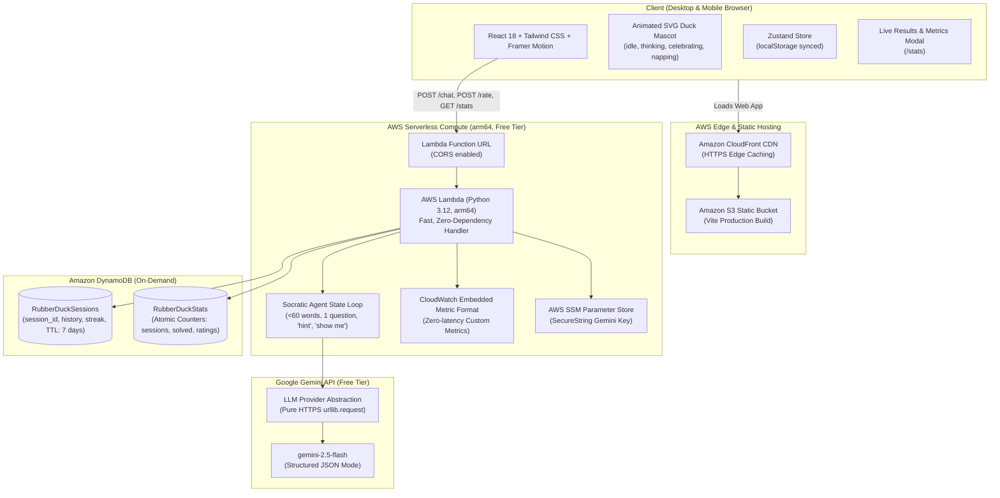

# 🦆 Rubber Duck — Socratic AI Debugging Companion

> An AI debugging coach for junior developers, bootcamp students, and engineers stuck on a bug. Instead of handing over the fix to blindly copy, the Duck coaches you by asking **exactly ONE question at a time** (under 60 words) until you spot the root cause yourself.

Built for the **AWS Builder Center Hackathon** • 100% AWS Free Tier Eligible • Sub-200ms Serverless Cold Starts.

---

## 🌟 Key Features

- **Socratic Coaching**: Never dumps raw code solutions. Asks exactly ONE focused debugging question at a time to lead you to the root cause.
- **Word-Count Constrained**: Duck responses are strictly under 60 words to keep cognitive load minimal.
- **Natural Commands**:
  - `hint`: Offers a gentle nudge or points attention to a specific variable/line without giving the answer.
  - `show me`: Provides the full explanation and code fix when you are truly blocked.
  - `I found it!`: Triggers celebration and saves your session.
- **Custom Animated Mascot**: Scalable vector mascot built with Framer Motion featuring 4 expressive states:
  - 🦆 `idle`: Breathing scale and periodic eye-blink.
  - 💭 `thinking`: Curious head tilt, bobbing motion, and floating thought bubbles.
  - 🎉 `celebrating`: Energetic hop, wing flapping, and canvas-confetti burst.
  - 💤 `napping`: Head droop, closed eyes, and floating `zZz` for friendly error recovery.
- **Solved Streak Tracking**: Tracks a persistent "solved without a fix" streak that only increments when you solve bugs autonomously.
- **What You Learned**: Generates a one-sentence takeaway upon solving each bug.
- **Live Hackathon Results Dashboard (`/stats`)**: Real-time aggregated metrics pulled directly from DynamoDB and CloudWatch EMF.
- **Accessible & Delightful**: WCAG AA contrast, dark/light themes, keyboard accessible (`Cmd/Ctrl+K` for new chat, `Esc` to skip typing effect), and responsive down to 360px mobile.

---

## 🏗️ Architecture



---

## 🛠️ AWS Services Used

| AWS Service | Role in Rubber Duck | Free Tier Coverage |
| :--- | :--- | :--- |
| **AWS Lambda** | Arm64 Python 3.12 microservice running behind Function URL | 1M free requests/mo |
| **Amazon DynamoDB** | Stores active sessions (with 7-day TTL) and global atomic counters | 25 GB free storage |
| **Amazon CloudWatch** | Embedded Metric Format (EMF) logs & custom metrics dashboard | 5 GB free logs/mo |
| **Amazon S3** | Hosts compiled React 18 production bundle | 5 GB free storage |
| **Amazon CloudFront** | Global edge CDN providing HTTPS and low-latency asset delivery | 1 TB free transfer/mo |
| **AWS Systems Manager** | SecureString Parameter Store for encrypted API key management | Always free |
| **AWS SAM** | Infrastructure as Code (IaC) orchestrating least-privilege IAM roles | Always free |

---

## 🚀 Quickstart

### Prerequisites
- Python 3.12+
- Node.js 18+ and npm
- AWS CLI and SAM CLI (for AWS deployment)
- A free Google Gemini API key from [Google AI Studio](https://aistudio.google.com/app/apikey)

### 1. Local Development (Offline / Mock Mode)
Run both backend and frontend locally without any cloud setup:

```bash
# 1. Clone repository
git clone https://github.com/your-username/rubber-duck.git
cd rubber-duck

# 2. Setup backend with Python venv
python3 -m venv .venv
source .venv/bin/activate
pip install -r backend/requirements.txt

# 3. Setup frontend
cd frontend
npm install

# 4. Start frontend dev server
npm run dev
```

### 2. Run Tests
```bash
# Run backend pytest suite (19 unit tests)
source .venv/bin/activate
PYTHONPATH=backend:. pytest backend/tests/ -v

# Run frontend Vitest suite (7 component tests)
cd frontend
npm test
```

### 3. Deploy to AWS
For complete, click-by-click beginner instructions, please follow [**MANUAL_STEPS.md**](file:///home/jawad/Weekend%20challenge/MANUAL_STEPS.md).

Quick deployment commands:
```bash
# Build and deploy backend to AWS
cd backend
sam build
sam deploy --guided

# Configure frontend with generated Lambda Function URL
cd ../frontend
echo "VITE_API_URL=<YOUR_FUNCTION_URL>" > .env.production
npm run build

# Deploy to S3 + CloudFront
aws s3 sync dist/ s3://<YOUR_BUCKET_NAME>/ --delete
```

---

## 📸 Screenshots & Showcase

| Idle Greeting ("Quack. What's broken?") | Socratic Debugging Dialogue |
| :---: | :---: |
|  |  |

| Solved Celebration & Recap Card | Live Results Dashboard |
| :---: | :---: |
|  |  |

---

## 🧪 Testing Summary

- **Backend (`pytest`)**: 19 tests covering:
  - Socratic prompt word constraints (<60 words)
  - Deterministic command handling (`hint`, `show me`, `I found it!`)
  - Streak increment rules (only increments if solved autonomously)
  - DynamoDB session capping & 7-day TTL calculations
  - CloudWatch EMF JSON payload compliance
  - All HTTP endpoints (`/chat`, `/rate`, `/stats`, `/health`) and CORS preflight
- **Frontend (`Vitest`)**: 7 tests covering:
  - Custom SVG Duck mascot animation states (`idle`, `thinking`, `celebrating`, `napping`)
  - Auto-growing composer, code mode toggles, character limit indicators, and chip actions.
- **Production Build**: Zero TypeScript errors, chunk-split into high-performance vendor and UI bundles (<160 kB gzip).

---

## 📜 License
MIT License. Created with ❤️ for the AWS Builder Center Hackathon.
