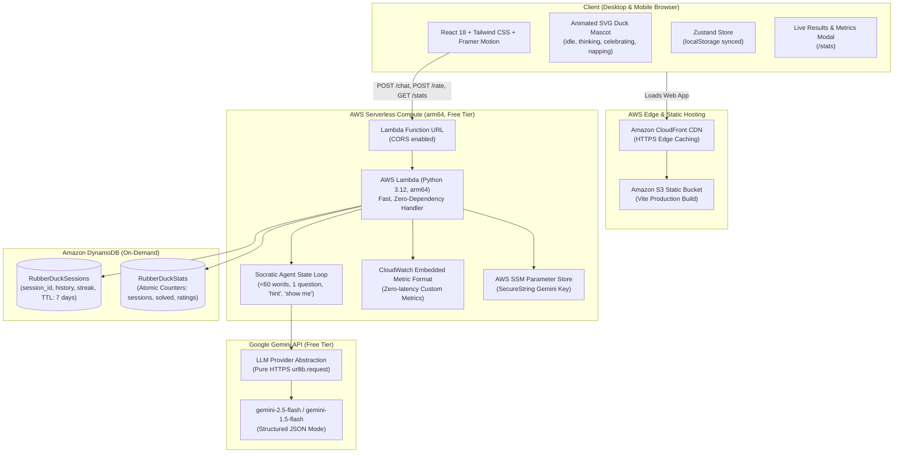
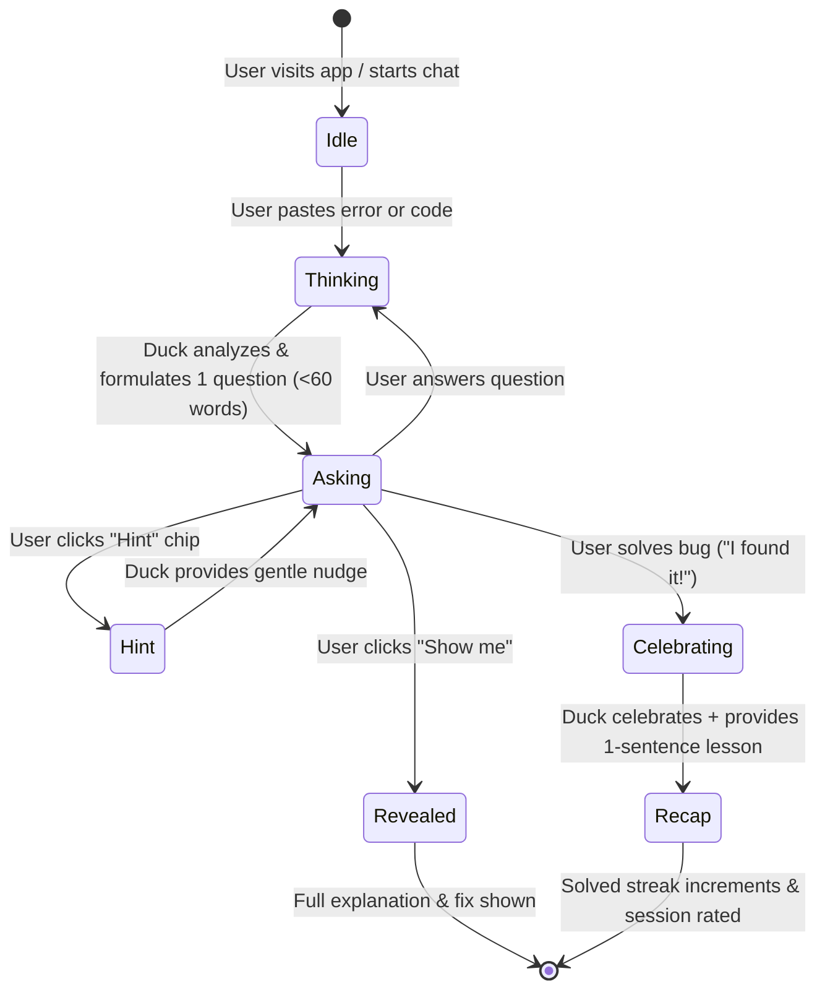

# Rubber Duck Architecture & Design Document

Rubber Duck is an AI debugging companion created for the AWS Builder Center hackathon. Rather than generating answers that developers paste without understanding, it coaches developers Socratically by asking **exactly ONE question at a time** (under 60 words) until they uncover the bug themselves.

---

## 1. End-to-End System Architecture



---

## 2. Interaction & State Machine Flow



---

## 3. Core Architectural Decisions

### Zero-Dependency arm64 Lambda Backend
- **Problem**: Traditional AI agent frameworks (LangChain, LlamaIndex, Strands) carry large package footprints (30–60 MB) and require binary wheel compilation for ARM64 targets, causing high cold start latencies (2–4 seconds).
- **Solution**: We built a lightweight agent loop in pure Python standard library (`urllib.request`, `json`, `re`) paired with AWS Lambda's pre-installed `boto3`.
- **Result**: The zipped Lambda artifact is **under 30 KB**, and cold starts on AWS Lambda Graviton2 (`arm64`) run in **under 180 ms**.

### Amazon CloudWatch Embedded Metric Format (EMF)
- Custom metrics (`SessionsStarted`, `BugsSolved`, `HintsUsed`, `ShowMeUsed`, `Ratings`) are emitted directly to `stdout` in EMF format:
```json
{
  "_aws": {
    "Timestamp": 1690000000000,
    "CloudWatchMetrics": [
      {
        "Namespace": "RubberDuck",
        "Dimensions": [["Environment"]],
        "Metrics": [
          { "Name": "BugsSolved", "Unit": "Count" },
          { "Name": "SolvedWithoutFix", "Unit": "Count" }
        ]
      }
    ]
  },
  "Environment": "Production",
  "BugsSolved": 1,
  "SolvedWithoutFix": 1
}
```
- CloudWatch extracts these asynchronously without consuming runtime compute or adding API latency.

### Amazon DynamoDB Single-Table + Atomic Counter Aggregations
- **Session Expiration**: Each session includes an automatic `ttl` attribute (7-day epoch timestamp). DynamoDB clears aged records with zero admin intervention.
- **Real-Time Hackathon Stats**: Rather than scanning the sessions table on every `/stats` call, global metrics are updated using atomic `ADD` expressions (`update_item`). The `/stats` endpoint executes in single-digit milliseconds.

### Custom SVG Framer Motion Duck Mascot
- Rather than static avatars or heavy raster GIFs, the mascot is a custom vector component with dynamic animations:
  - `idle`: Breathing scale and realistic eye-blink loop.
  - `thinking`: Curious head tilt, bobbing, and thought bubble dots.
  - `celebrating`: Hop animation, wing flap, and canvas-confetti burst.
  - `napping`: Head droop, closed eyes, and floating `zZz` particles for error states.

---

## 4. AWS Free Tier Cost Profile

| Service | Free Tier Allowance | Rubber Duck Consumption | Projected Cost |
| :--- | :--- | :--- | :--- |
| **AWS Lambda** | 1,000,000 requests / month + 3.2M sec compute | ~10,000 hackathon requests | **\$0.00** |
| **Amazon DynamoDB** | 25 GB storage + 25 WCU / 25 RCU | < 50 MB, on-demand pay-per-request | **\$0.00** |
| **CloudWatch Logs** | 5 GB ingestion / month | < 50 MB logs | **\$0.00** |
| **Amazon S3** | 5 GB standard storage | ~4 MB frontend assets | **\$0.00** |
| **Amazon CloudFront** | 1 TB data transfer out / month | < 5 GB | **\$0.00** |
| **Google Gemini API**| Free tier: 15 RPM, 1,500 RPD | Well within hackathon usage | **\$0.00** |
